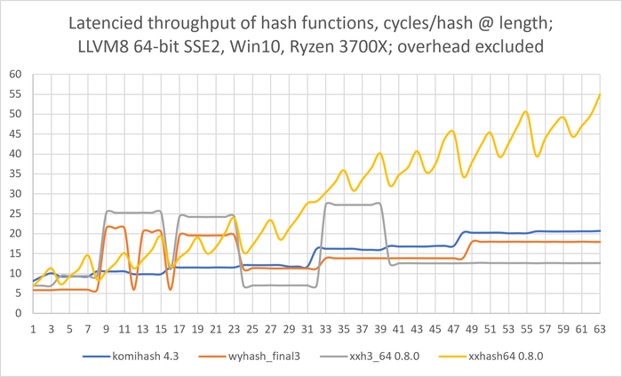

# KOMIHASH - Very Fast Hash Function (in C/C++)

## Introduction

The `komihash()` function, available in the `komihash.h` header file,
implements a very fast 64-bit hash function designed primarily for hash
tables, hash maps, and Bloom filters. It produces identical hashes on big- and
little-endian systems. It is suitable for hashing files and large datasets,
and for generating checksums. The code for this function is portable,
cross-platform, scalar, zero-allocation, and header-only, with inlining
support. It is also compatible with C++.

`komihash` features both high speed for large-block hashing (27 GB/s on
a Ryzen 3700X) and high throughput for small strings or messages (about 8
cycles per hash for strings of 0 to 15 bytes when hashes are computed
repeatedly). However, performance on 32-bit systems is considerably lower than
on 64-bit systems. Furthermore, large-block hashing performance on big-endian
systems may be 20% lower than on little-endian systems due to the need for
byte-swapping (which can be disabled with a macro definition).

Technically, `komihash` is similar to hash functions such as `wyhash` and
`CircleHash`, which are, in turn, similar to the `lehmer64` PRNG. However,
`komihash` is structurally different from them in that it accumulates the
full 128-bit multiplication result without folding it into a single 64-bit
state variable. Thus, `komihash` does not lose the distinction between
consecutive states, while other hash functions may do so.

Another important difference between `komihash` and these functions is that it
parses the input message without overlap. While overlaps allow a function to
use fewer branches, they are considered "non-ideal" because they potentially
cause collisions and seed-value flaws. In addition, `komihash` features
superior seed-value handling and Perlin noise hashing support.

It is worth noting that `komihash` uses, at its core, a simple mathematical
construct and contains no arbitrarily chosen or artificially tuned constants.
The base state of the function consists of the first few digits of the
fractional part of pi, and this state can be replaced with any uniformly
distributed random values. This means that the statistical properties
(collision resistance) of `komihash` are based not on manual fine-tuning but
rather on its mathematical construct.

Note that `komihash` is not cryptographically secure. In open systems and
internal server-side data structures, it should be used only with a secret
seed to minimize the risk of collision attacks (hash flooding). However, using
the default seed (0) reduces overhead by 1-2 cycles/hash (depending on the
compiler).

The function passes all [SMHasher](https://github.com/rurban/smhasher) and
[SMHasher3](https://gitlab.com/fwojcik/smhasher3/-/tree/main/results) tests.
The function was also tested with the [xxHash collision tester](https://github.com/Cyan4973/xxHash/tree/dev/tests/collisions)
under various settings, and the collision statistics met expectations.
The performance of this hash function on various platforms is best evaluated
via the [ECRYPT/eBASH project](https://bench.cr.yp.to/results-hash.html).
Credit is due to [Daniel J. Bernstein](https://en.wikipedia.org/wiki/Daniel_J._Bernstein)
for maintaining the benchmark.

This function's source code conforms to [ISO C99](https://en.wikipedia.org/wiki/C99)
and has been tested with Clang, GCC, MSVC, and the Intel C++ compiler on x86,
x86-64 (Intel, AMD), and AArch64 (Apple Silicon) systems running Windows 10,
Windows 11, AlmaLinux 9.6, and macOS 26.4. Full C++ compatibility is
automatically provided when the source code is compiled with a C++ compiler.

## Usage

```c
#include <stdio.h>
#include "komihash.h"

int main(void)
{
    const char s1[] = "This is a test of komihash.";
    const char s2[] = "7 chars";

    printf( "%016llx\n", komihash( s1, strlen( s1 ), 0 )); // 5b13177fc68b4f96
    printf( "%016llx\n", komihash( s2, strlen( s2 ), 0 )); // 2c514f6e5dcb11cb
}
```

## Pre-seeding

It is often desirable to set a specific random seed statically and then use it
with the hash function throughout the program's execution. This has the
benefit of improving hashing throughput without compromising hash quality.

With pre-seeding, a context structure should be initialized once and then
passed to the `komihash_with_preseed()` function.

```c
#include <stdio.h>
#include "komihash.h"

int main(void)
{
    const char s1[] = "This is a test of komihash.";
    const char s2[] = "7 chars";

    komihash_preseed_t ps;
    komihash_set_preseed( &ps, 123 );

    printf( "%016llx\n", komihash_with_preseed( s1, strlen( s1 ), &ps )); // b95100a356103a59
    printf( "%016llx\n", komihash_with_preseed( s2, strlen( s2 ), &ps )); // d014608da8d421e9

    printf( "%016llx\n", komihash( s1, strlen( s1 ), 123 )); // b95100a356103a59
    printf( "%016llx\n", komihash( s2, strlen( s2 ), 123 )); // d014608da8d421e9
}
```

## Discrete-Incremental Hashing

The correct way to hash an array of independent values without pre-buffering
is to pass the previous hash value as a seed value. This method may be as fast
as or faster than pre-buffering, especially if the values in the array are
large. If fixed-size values are being hashed incrementally, this approach
reduces overhead by an additional 1-2 cycles/hash (due to the compiler's
branch optimizations). In most cases, incremental hashing of even a few 2- to
8-byte values may be faster than pre-buffering if the overall input length is
not known in advance.

```c
uint64_t HashVal = komihash( &val1, sizeof( val1 ), Seed );
HashVal = komihash( &val2, sizeof( val2 ), HashVal );
...
HashVal = komihash( &valN, sizeof( valN ), HashVal );
```

Note that this approach is not the same as "streamed" hashing, since it
implicitly encodes the length of each independent value. This kind of hashing
can be beneficial when a database record is being hashed and it is necessary
to distinguish fields by encoding their lengths.

Discrete-incremental hashing of nested structures requires a "hash-value
stack." The current hash value is pushed onto the stack at each nesting level,
and each nesting level starts with the hash value 0. When that nesting level
is exited, the resulting value is hashed together with the popped hash value.

## Streamed Hashing

The `komihash.h` header file also features a fast streaming implementation of
the `komihash()` function. Streamed hashing accepts any number of `update`
calls between the `init` and `final` calls:

```c
komihash_stream_t ctx;
komihash_stream_init( &ctx, UseSeed );

komihash_stream_update( &ctx, &val1, sizeof( val1 ));
komihash_stream_update( &ctx, &val2, sizeof( val2 ));
...
komihash_stream_update( &ctx, &valN, sizeof( valN ));

uint64_t Hash = komihash_stream_final( &ctx );
```

Since the `final` function does not destructively alter the context structure,
it can be used to obtain intermediate "incremental" hashes of the data stream
being hashed, and hashing can then be resumed.

The hash value produced via streamed hashing can be combined with the
discrete-incremental hashing approach outlined above (e.g., for files and
blobs).

You may also consider using [PRVHASH64S](https://github.com/avaneev/prvhash),
which provides a hashing throughput of 8.5 GB/s on a Ryzen 3700X and can
produce a hash value of any required bit width.

## Ports

* [C++, via vcpkg](https://vcpkg.link/ports/komihash)
* [C3, by NotsoanoNimus](https://github.com/c3lang/c3c/blob/master/lib/std/hash/komi.c3)
* [Crystal, by Coral Pink](https://repo.or.cz/komihash.cr.git)
* [Java, by Dynatrace](https://github.com/dynatrace-oss/hash4j)
* [Lua, by rangercyh](https://github.com/rangercyh/lua-komihash)
* [.NET, by TommasoBelluzzo](https://www.nuget.org/packages/FastHashes/)
* [Perl, by scottchiefbaker](https://github.com/scottchiefbaker/perl-Crypt-Komihash)
* [Rust, by thynson](https://crates.io/crates/komihash)

## Customizing the C++ Namespace

In C++ environments where it is undesirable to place `komihash` symbols into
the global namespace, the `KOMIHASH_NS_CUSTOM` macro can be defined
externally:

```c++
#define KOMIHASH_NS_CUSTOM komihash
#include "komihash.h"
```

Similarly, `komihash` symbols can be placed into any other custom namespace
(e.g., a namespace for hash functions):

```c++
#define KOMIHASH_NS_CUSTOM my_hashes
#include "komihash.h"
```

As a result, `komihash` functions can be referred to as
`my_hashes::komihash(...)`. Note that because all `komihash` functions are
declared with the `static` specifier, there will be no ABI conflicts, even if
the `komihash.h` header is included in multiple C/C++ translation units.

## Comparisons

The table below presents a performance comparison across different compilers
and platforms that the author used during the development of `komihash`.

1. LLVM clang-cl 18.1.8 x86-64, Windows 10, Ryzen 3700X (Zen 2), 4.2 GHz.
Compiler options: `/Ox -msse2`.
2. LLVM clang-cl 18.1.8 x86-64, Windows 10, Ryzen 3700X (Zen 2), 4.2 GHz.
Compiler options: `/Ox -mavx2`.
3. ICC 19.0 x86-64, Windows 10, Ryzen 3700X (Zen 2), 4.2 GHz.
Compiler options: `/O3 /QxSSE2`.
4. LLVM clang 19.1.7 x86-64, AlmaLinux 9.6, Xeon E-2386G (Rocket Lake), 5.1 GHz.
Compiler options: `-O3 -mavx2`.
5. GCC 11.5.0 x86-64, AlmaLinux 9.6, Xeon E-2386G (Rocket Lake), 5.1 GHz.
Compiler options: `-O3 -msse2`.
6. GCC 11.5.0 x86-64, AlmaLinux 9.6, Xeon E-2386G (Rocket Lake), 5.1 GHz.
Compiler options: `-O3 -mavx2`.
7. LLVM clang-cl 18.1.8 x86-64, Windows 10, Core i7-7700K (Kaby Lake), 4.5 GHz.
Compiler options: `/Ox -mavx2`.
8. ICC 19.0 x86-64, Windows 10, Core i7-7700K (Kaby Lake), 4.5 GHz.
Compiler options: `/O3 /QxSSE2`.
9. Apple clang 15.0.0 arm64, macOS 26.4, Apple M1, 3.5 GHz.
Compiler options: `-O3`.
10. LLVM clang-cl 18.1.8 x86-64, Windows 11, Ryzen 9950X (Zen 5), 5.7 GHz.
Compiler options: `/Ox -msse2`.

|Platform         |1                |1              |1              |2      |2    |2   |3      |3    |3   |4      |4    |4   |5      |5    |5   |6      |6    |6   |7      |7    |7   |8      |8    |8   |9      |9    |9   |10     |10   |10  |
|-----------------|-----------------|---------------|---------------|-------|-----|----|-------|-----|----|-------|-----|----|-------|-----|----|-------|-----|----|-------|-----|----|-------|-----|----|-------|-----|----|-------|-----|----|
|Hash function    |`0-15b, cycles/h`|8-28b, cycles/h|bulk, GB/s     |`0-15b`|8-28b|bulk|`0-15b`|8-28b|bulk|`0-15b`|8-28b|bulk|`0-15b`|8-28b|bulk|`0-15b`|8-28b|bulk|`0-15b`|8-28b|bulk|`0-15b`|8-28b|bulk|`0-15b`|8-28b|bulk|`0-15b`|8-28b|bulk|
|**komihash 5.34**|`9.7`            |11.2           |27.6           |`9.7`  |11.2 |27.6|`11.8` |13.7 |23.4|`9.9`  |11.3 |31.9|`9.9`  |11.4 |31.1|`9.9`  |11.2 |31.0|`12.0` |13.3 |22.9|`14.0` |16.7 |19.3|`8.0`  |7.9  |23.6|`7.0`  |8.0  |42.7|
|wyhash_final4    |`14.5`           |18.2           |29.3           |`14.7` |18.2 |29.3|`25.9` |32.9 |12.5|`16.8` |21.5 |34.5|`17.1` |22.8 |35.6|`17.2` |22.8 |35.7|`15.5` |20.4 |29.8|`21.1` |26.1 |19.4|`7.9`  |8.1  |26.1|`13.9` |18.5 |41.7|
|XXH3_64 0.8.0    |`15.5`           |28.8           |30.0           |`15.5` |28.7 |61.8|`21.8` |27.2 |29.6|`18.4` |24.3 |68.4|`19.0` |25.1 |33.9|`19.7` |25.8 |65.8|`18.4` |23.0 |48.3|`19.9` |25.8 |28.0|`8.2`  |8.2  |30.5|`15.4` |31.0 |50.3|
|XXH64 0.8.0      |`12.5`           |17.5           |17.2           |`12.5` |17.5 |17.3|`24.3` |36.6 |8.9 |`10.4` |14.2 |20.1|`11.1` |14.5 |20.2|`11.1` |14.6 |20.1|`13.2` |17.3 |17.7|`18.8` |24.7 |16.0|`8.8`  |10.4 |14.5|`9.1`  |12.7 |31.4|
|(overhead)       |1.8              |1.8            |0              |1.8    |1.8  |0   |1.9    |1.9  |0   |3.9    |3.9  |0   |3.6    |3.6  |0   |2.8    |2.8  |0   |5.5    |5.5  |0   |5.9    |5.9  |0   |1.5    |1.5  |0   |1.0    |1.0  |0   |

Notes: `XXH3_64` is unseeded (the seeded variant incurs an additional 1
cycle/h). `bulk` is 256000 bytes: this test mainly represents cache-bound
performance and does not reflect high-load situations. `GB/s` should not be
misinterpreted as `GiB/s`. `cycles/h` means `processor clock ticks per hash
value`, including overhead. The margin of error is approximately 3%.

### Averages over all measurements (overhead excluded)

|Hash function    |0-15b, cycles/h|8-28b, cycles/h|
|-----------------|---------------|---------------|
|**komihash 5.34**|**7.2**        |**8.6**        |
|komihash 5.10    |8.2            |9.8            |
|komihash 4.5     |9.5            |11.4           |
|komihash 4.3     |10.4           |12.1           |
|komihash 3.6     |10.9           |15.4           |
|komihash 2.8     |11.8           |16.7           |
|wyhash_final4    |13.5           |18.0           |
|XXH3_64 0.8.0    |14.2           |21.8           |
|XXH64 0.8.0      |10.2           |15.0           |

This is a throughput comparison of hash functions on a Ryzen 3700X.



The code below was used to obtain the `cycles/h` values. Note that this
method measures "raw" throughput; in this scenario, the processor's branch
predictor adapts to a specific message length and a specific memory address.
Practical performance depends on the statistical properties of the strings
(messages) being hashed, including memory access patterns.

This method measures the hash function's sequential throughput because the
`volatile` qualifier prevents out-of-order execution, forcing sequential
evaluation.

Note that some hash functions may favor certain message lengths. In this
respect, `komihash` does not "favor" any specific length; thus, it is more
versatile. Throughput aside, hashing quality is also an important factor,
since it influences the creation of a hash map and subsequent lookups. This
test, along with many other synthetic hash-function tests, should be
interpreted with caution. Only actual use cases can reveal which hash function
is preferable.

```c++
const uint64_t rc = 1ULL << 26;
const int minl = 8; const int maxl = 28;
volatile uint64_t msg[ 8 ] = { 0 };
uint64_t v = 0;

const TClock t1( CSystem::getClock() );

for( int k = minl; k <= maxl; k++ )
{
    volatile size_t msgl = k;
    volatile uint64_t sd = k + 1;

    for( uint64_t i = 0; i < rc; i++ )
    {
        v ^= komihash( (uint8_t*) &msg, msgl, sd );
//        v ^= wyhash( (uint8_t*) &msg, msgl, sd, _wyp );
//        v ^= XXH3_64bits( (uint8_t*) &msg, msgl );
//        v ^= msg[ 0 ]; // Used to estimate the overhead.
        msg[ 0 ]++;
    }
}

printf( "%016llx\n", v );
printf( "%.1f\n", CSystem::getClockDiffSec( t1 ) * 4.2e9 /
    ( rc * ( maxl - minl + 1 ))); // 5.1 on Xeon, 4.5 on i7700K, 3.5 on M1
```

## Discussion

Does `komihash` feature identity hashing? No, it does not. If you are using
fixed-size keys, it is advisable to use direct key values rather than those
produced by a hash function. Adding the identity hashing feature to any hash
function increases overhead.

You may wonder why `komihash` does not include a fairly common instruction
that XORs the state and the message length (`^MsgLen`). The main reason is the
way `komihash` parses the input message: such an instruction is not necessary.
Another reason is that for a non-cryptographic hash function, this step
provides no additional security. While it may seem to protect against simple
"state-XOR" collision attacks, in practice it offers no protection given the
power of [SAT solvers](https://github.com/pysathq/pysat). In less than a
second, a SAT solver can forge a preimage that produces the required hash
value. It is also important to note that in fast hash functions such as
`komihash`, the input message completely determines the state variables and
the result.

Is a 128-bit version of this hash function planned? Probably not. While such
a version may be reasonable for data structure compatibility reasons, there is
little practical benefit in using 128-bit hashes on the local scale:
a reliable 64-bit hash can accommodate 2.1 billion diverse binary objects
(e.g., files in a file system or entries in a hash map) with a low probability
of collisions. On the other hand, on the global scale, 128-bit hashes are
clearly insufficient, considering the multitude of digital devices and the
diverse binary objects (e.g., files and records in databases) on each device.

Regarding the "bulk" performance of "fast" hash functions in most practical
situations: when the processor's total memory bandwidth is limited (e.g.,
to 41 GB/s), single-threaded hashing performance on the order of 30 GB/s is
excessive. This is because memory bandwidth must be shared among multiple
cores. Therefore, in practice, such a "fast" hash function, running on
a heavily loaded 8-core server, rarely has more than 8 GB/s of bandwidth
available. Moreover, a server rarely has more than 10 Gbit/s of network
connectivity, which further reduces the throughput available for hashing
incoming data. The same applies to disk throughput if the data has not yet
been loaded into memory.

## KOMIRAND

The `komirand()` function, available in the `komihash.h` header file,
implements a simple, reliable, self-starting, and fast (`0.62` cycles/byte)
64-bit pseudorandom number generator (PRNG) with a period of `2^64`. It is
based on the same mathematical construct as the `komihash` function.
`komirand` passes `PractRand` tests (tested up to 32 TiB with the default
settings).

The PRNG has a 128-bit state composed of two unsigned 64-bit integers
($s_{1}$ and $s_{2}$).

$$\begin{aligned}
m_{128} &= s_{1} \cdot s_{2} \\
rh &= \left\lfloor \frac{m_{128}}{2^{64}} \right\rfloor \\
s_{2}' &= (s_{2} + rh + C_1) \mod 2^{64} \\
s_{1}' &= ((m_{128} \mod 2^{64} \oplus rh) + C_2) \mod 2^{64} \\
\end{aligned}$$

$C_1$ and $C_2$ can be any 64-bit constants (to provide the PRNG's
self-starting capability from the $m_{128}=0$ state) or zero if such
self-starting is not needed. $s_{1}'$ is used as the PRNG output.

This construct can be scaled to registers of any even bit width (e.g., 32,
48, or 64 bits); it is invariant with respect to the register size.
The constants used in `komirand` (`0x5555...` and `0xAAAA...`) are a good
choice because they carry no bitwise spectral information, and their influence
on the statistical and spectral properties is minimal.

Note that although this PRNG is classified as "chaotic", one should not assume
that it can enter degenerate cycles (with these specific constants in use).
When properly initialized, it does not exhibit degenerate cycles, regardless
of the initial state.

For hashing, the following "hardened" constant-less construct is used:

$$\begin{aligned}
m_{128} &= (s_{1} \oplus x_{1}) \cdot (s_{2} \oplus x_{2}) \\
rh &= \left\lfloor \frac{m_{128}}{2^{64}} \right\rfloor \\
s_{2}' &= (s_{2} + rh) \mod 2^{64} \\
s_{1}' &= m_{128} \mod 2^{64} \oplus s_{2}' \\
\end{aligned}$$

Here, $x_{1}$ and $x_{2}$ are 64-bit portions of the message or string being
hashed. Since $s_{1}$ and $s_{2}$ are uniformly distributed values, such
mixing is equivalent to mixing the message with a cryptographic one-time pad
(bitwise addition modulo 2). The message's statistical distribution is
irrelevant and does not affect the uniform distribution of $s_{1}$ and
$s_{2}$.

```c
#include <stdio.h>
#include "komihash.h"

int main(void)
{
    uint64_t Seed1 = 0, Seed2 = 0;
    int i;

    for( i = 0; i < 8; i++ )
    {
        printf( "%016llx\n", komirand( &Seed1, &Seed2 ));
    }
}
```

Output:

```
5555555555555555
79e79e79e79e79e6
af5b2bd6caf5b2bc
eed5a85374f06b25
1c42877a440ae8ee
0f45472b14548870
45f57b7d95187bbe
f24fa16f6f3733b2
```

## Etymology

`komihash` is named in honor of the [Komi Republic](https://en.wikipedia.org/wiki/Komi_Republic)
(located in Russia), the author's native region.

According to [Sarmatiae Europeae descriptio](https://www.digitale-sammlungen.de/en/details/bsb11202361)
by Alexander Gwagnin in 1581 (Moschoviae Descriptio, p. 86b), the territory of
the Komi Republic was internationally known as Condora Regio, inhabited by
people worshiping a golden goddess, Zarni Ana, who shone like the sun. This
goddess is often depicted holding a child and a spear. Her name is usually
translated as Zlatababa.

Condora is also mentioned as a territory near the Mezen River on the map
produced by the Englishman Anthony Jenkinson in 1562. "Condora" may have meant
"pine country," derived from the Komi words "conda" (pine) and "dor" (region,
land area, country). The southern part of the modern Komi Republic near the
Vychegda and Vishera Rivers was known as Permia (Christianized under Bishop
Stephen Velickopermsky), a region that does not correspond to the modern Perm
region near the Kama River.

## Test Vectors

Test vectors for the current version of `komihash` consist of string-hash
pairs (note that the quotation marks are not included in the calculation).
The `bulk` buffer contains an incrementing sequence of 8-bit values; `bulk`
hashes are calculated from this buffer at various lengths. See the `testvec.c`
source file for details.

```
komihash UseSeed = 0x0000000000000000:
"This is a 32-byte testing string" = 0x05ad960802903a9d
"The cat is out of the bag" = 0xd15723521d3c37b1
"A 16-byte string" = 0x467caa28ea3da7a6
"The new string" = 0xf18e67bc90c43233
"7 chars" = 0x2c514f6e5dcb11cb
bulk(3) = 0x7a9717e9eea4be8b
bulk(6) = 0xa56469564c2ea0ff
bulk(8) = 0x00b4313a24431306
bulk(12) = 0x64c2ad96013f70fe
bulk(20) = 0x7a3888bc95545364
bulk(31) = 0xc77e02ed4b201b9a
bulk(32) = 0x256d74350303a1ba
bulk(40) = 0x59609c71697bb9df
bulk(47) = 0x36eb9e6a4c2c5e4b
bulk(48) = 0x8dd56c332850baa6
bulk(56) = 0xcbb722192b353999
bulk(64) = 0x90b07e2158f88cc0
bulk(72) = 0x24c9621701603741
bulk(80) = 0x1d4c1d97ca684334
bulk(112) = 0xd1a425d530652287
bulk(132) = 0x72623be342c20ab5
bulk(256) = 0x94c3dbdca59ddf57

komihash UseSeed = 0x0123456789abcdef:
"This is a 32-byte testing string" = 0x6ce66a2e8d4979a5
"The cat is out of the bag" = 0x5b1da0b43545d196
"A 16-byte string" = 0x26af914213d0c915
"The new string" = 0x62d9ca1b73250cb5
"7 chars" = 0x90ab7c9f831cd940
bulk(3) = 0x84ae4eb65b96617e
bulk(6) = 0xaceebc32a3c0d9e4
bulk(8) = 0xdaa1a90ecb95f6f8
bulk(12) = 0xec8eb3ef4af380b4
bulk(20) = 0x07045bd31abba34c
bulk(31) = 0xd5f619fb2e62c4ae
bulk(32) = 0x5a336fd2c4c39abe
bulk(40) = 0x0e870b4623eea8ec
bulk(47) = 0xe552edd6bf419d1d
bulk(48) = 0x37d170ddcb1223e6
bulk(56) = 0x1cd89e708e5098b6
bulk(64) = 0x765490569ccd77f2
bulk(72) = 0x19e9d77b86d01ee8
bulk(80) = 0x25f83ee520c1d241
bulk(112) = 0xd6007417091cd4c0
bulk(132) = 0x3e49c2d3727b9cc9
bulk(256) = 0xb2b3405ee5d65f4c

komihash UseSeed = 0x0000000000000100:
"This is a 32-byte testing string" = 0x5f197b30bcec1e45
"The cat is out of the bag" = 0xa761280322bb7698
"A 16-byte string" = 0x11c31ccabaa524f1
"The new string" = 0x3a43b7f58281c229
"7 chars" = 0xcff90b0466b7e3a2
bulk(3) = 0x8ab53f45cc9315e3
bulk(6) = 0xea606e43d1976ccf
bulk(8) = 0x889b2f2ceecbec73
bulk(12) = 0xacbec1886cd23275
bulk(20) = 0x57c3affd1b71fcdb
bulk(31) = 0x7ef6ba49a3b068c3
bulk(32) = 0x49dbca62ed5a1ddf
bulk(40) = 0x192848484481e8c0
bulk(47) = 0x420b43a5edba1bd7
bulk(48) = 0xd6e8400a9de24ce3
bulk(56) = 0xbea291b225ff384d
bulk(64) = 0x0ec94062b2f06960
bulk(72) = 0xfa613272ecd49985
bulk(80) = 0x76f0bb380bc207be
bulk(112) = 0x4afb4e08ca77c020
bulk(132) = 0x410f9c129ad88aea
bulk(256) = 0x066c7b25f4f569ae

komirand Seed1/Seed2 = 0x0000000000000000:
0x5555555555555555
0x79e79e79e79e79e6
0xaf5b2bd6caf5b2bc
0xeed5a85374f06b25
0x1c42877a440ae8ee
0x0f45472b14548870
0x45f57b7d95187bbe
0xf24fa16f6f3733b2
0x34ea4920dced05f2
0xecb7a488c91c6b30
0xccf97a0677013efc
0x3a0b6c6188146bc3

komirand Seed1/Seed2 = 0x0123456789abcdef:
0x31f9fec3a216a8e2
0x3b9a95c9960f2e0b
0x598a4ee1bda1bb7b
0xa1d31cdf930f8008
0x19a95c363ccfdb39
0x1a24fa564cd4f59e
0x2c8fa55ab9c0e3d7
0x05f18c498f4ea766
0x54a2e5df8f4bf2ec
0x0d93606f32af73f5
0x727533e108541de9
0x2304050a71385a42

komirand Seed1/Seed2 = 0x0000000000000100:
0x5555555555565555
0x79e79e79e69de7e6
0x50e512e49e38e3f3
0x9c69166a0a85e8bb
0xd46eb0849ece68e8
0xa1a7a0a02bd44f77
0x73b523fe1127610c
0x3b9743566f8cc553
0xf2c8f20c192716b8
0xedeb9fe484d6c18c
0x514c781eeae7b289
0x0c662c62b8405bd6

```
